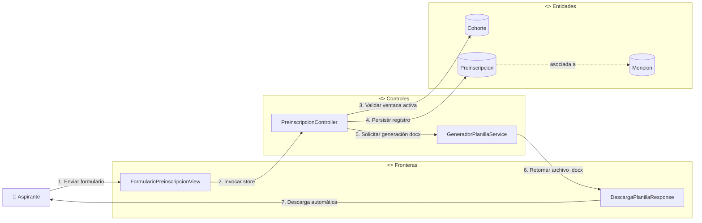
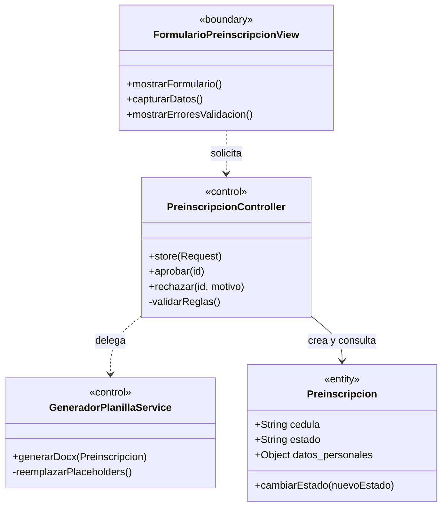

# Guía de Modelo de Análisis y Clases de Análisis (BCE)

El **Modelo de Análisis** sirve como puente entre los casos de uso (los requisitos) y el diseño de la arquitectura. Utiliza el patrón **BCE (Boundary - Control - Entity)** introducido en el proceso unificado (RUP / Jacobson).

---

## 1. Estereotipos de Análisis

1. **Frontera (`<<boundary>>` / Interfaz):**
   * Modela la interacción entre el sistema y sus actores externos.
   * Representa formularios, páginas Blade, diálogos modales, respuestas JSON o endpoints de APIs externas.
   * *Regla:* Los actores solo se comunican directamente con clases Frontera.

2. **Control (`<<control>>` / Coordinador):**
   * Encapsula la lógica de control, casos de uso, orquestación de transacciones y reglas de negocio del flujo.
   * Representa Controllers, Services, Listeners o Handlers.
   * *Regla:* Un controlador coordina objetos frontera y objetos entidad.

3. **Entidad (`<<entity>>` / Datos):**
   * Modela la información persistente y duradera del sistema.
   * Representa modelos de datos o registros de negocio (ej. `Postgrado`, `Cohorte`, `Preinscripcion`).
   * *Regla:* Las entidades no se comunican directamente con las fronteras; siempre median los objetos de control.

---

## 2. Reglas de Conexión de Robustez

| Desde \ Hacia | Frontera (`<<boundary>>`) | Control (`<<control>>`) | Entidad (`<<entity>>`) |
| :--- | :--- | :--- | :--- |
| **Actor** |  Válido |  Inválido |  Inválido |
| **Frontera** |  Inválido |  Válido |  Inválido |
| **Control** |  Válido |  Válido |  Válido |
| **Entidad** |  Inválido |  Válido |  Válido |

---

## 3. Diagrama de Robustez en Mermaid (`flowchart LR`)

---

## 4. Diagrama de Clases de Análisis (`classDiagram`)

Representa las clases con sus estereotipos y métodos de análisis conceptuales:

