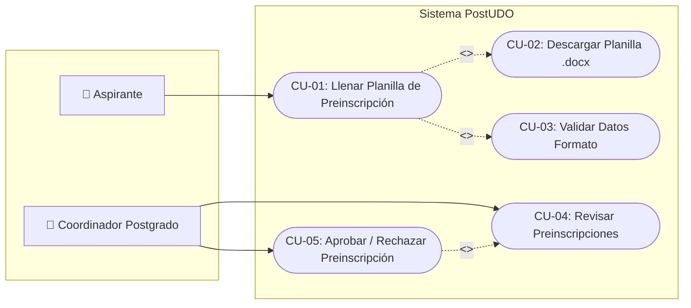

# Guía de Casos de Uso y Requerimientos del Sistema

Esta referencia detalla el estándar para documentar requerimientos del sistema y diagramas de casos de uso.

---

## 1. Requerimientos del Sistema

### Matriz de Requerimientos Funcionales (RF)
| Código | Nombre | Descripción | Prioridad | Actor Principal |
| :--- | :--- | :--- | :--- | :--- |
| **RF-01** | *Nombre del Requisito* | *Descripción clara de la capacidad que el sistema debe proveer.* | Alta / Media / Baja | *Rol involucrado* |

### Matriz de Requerimientos No Funcionales (RNF)
| Código | Categoría | Descripción | Métrica / Criterio |
| :--- | :--- | :--- | :--- |
| **RNF-01** | Seguridad / Rendimiento / Usabilidad | *Descripción del atributo de calidad o restricción técnica.* | *Criterio verificable* |

---

## 2. Ficha de Especificación de Caso de Uso (Formato Estándar)

* **Código:** `CU-XX`
* **Nombre:** *Verbo en infinitivo + objeto (ej. Registrar Preinscripción)*
* **Actor Principal:** *Rol que inicia la acción*
* **Actores Secundarios:** *Sistemas o roles que intervienen pasivamente*
* **Precondiciones:**
  1. *Condición 1 necesaria antes de iniciar.*
* **Flujo Principal (Escenario Ideal):**
  1. El actor solicita...
  2. El sistema valida...
  3. El actor introduce los datos...
  4. El sistema almacena y confirma...
* **Flujos Alternativos / Excepciones:**
  * **2a. Datos inválidos:** El sistema resalta los campos con error y solicita corrección.
  * **4a. Fallo de conexión externa:** El sistema notifica al usuario y reintenta más tarde.
* **Postcondiciones:**
  * *Estado final del sistema tras completarse con éxito.*

---

## 3. Diagrama de Casos de Uso en Mermaid

Para representar casos de uso en Mermaid, se utiliza `flowchart LR` con subgrafos que delimitan la frontera del sistema:

* **Actores:** `actorId["fa:fa-user NombreActor"]` o nodos con forma de persona/caja estilizada.
* **Casos de Uso:** Nodos con bordes redondeados u óvalos `([CU-01: Nombre del Caso])`.
* **Relaciones:**
  * Asociación simple: `-->`
  * Inclusión: `-.->|"<<include>>"|`
  * Extensión: `-.->|"<<extend>>"|`
  * Generalización: `---|Herencia|`

### Ejemplo en Mermaid:

