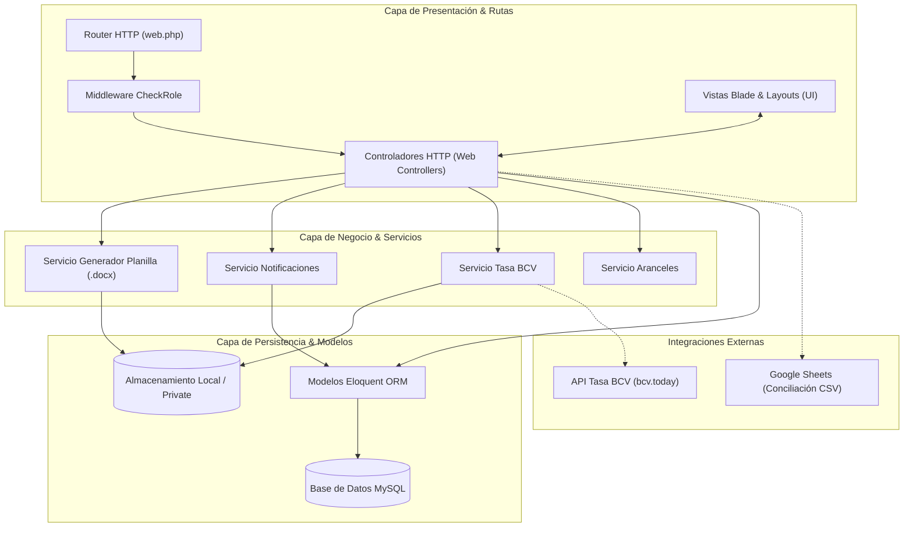

# Guía de Diagrama de Componentes y Arquitectura

El **Diagrama de Componentes** describe la organización y dependencias entre los módulos de software, subsistemas, capas y servicios externos.

---

## 1. Capas y Elementos Habituales en Aplicaciones Web (Monolito Laravel)

1. **Capa de Presentación / UI:**
   * Vistas Blade, layouts, scripts de cliente (JavaScript nativo, Alpine.js), controladores HTTP (`Controllers`) y middlewares de autenticación/roles (`CheckRole`).
2. **Capa de Negocio / Servicios:**
   * Servicios especializados (`NotificacionService`, `TasaCambioService`, `GeneradorPlanillaPreinscripcion`, `ArancelesService`).
   * Validaciones de reglas de negocio, autorizaciones y transacciones.
3. **Capa de Datos / Persistencia:**
   * Modelos Eloquent (`User`, `Postgrado`, `Cohorte`, `Preinscripcion`, `Pago`, `Egreso`).
   * Base de datos relacional (MySQL).
   * Almacenamiento local de archivos y configuraciones (`storage/app/private`).
4. **Servicios e Integraciones Externas:**
   * API de tasa de cambio (BCV Today).
   * Hojas de cálculo de conciliación (Google Sheets CSV).

---

## 2. Diagrama de Componentes en Mermaid (`flowchart TD`)

Se representan los componentes agrupados por subsistemas o capas mediante `subgraph`:

