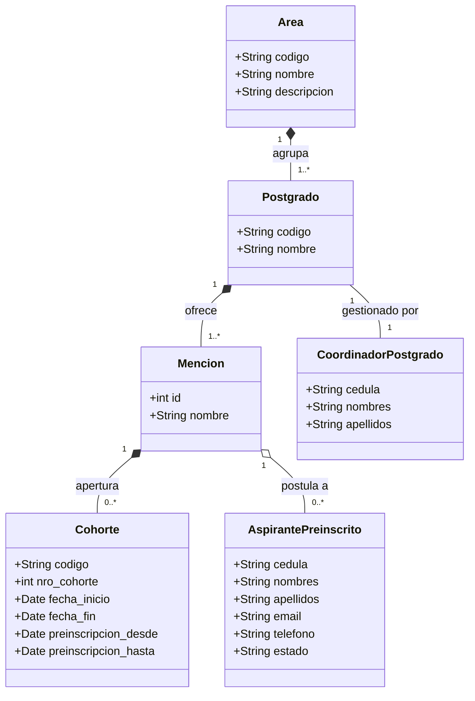

# Guía de Modelo de Dominio

El **Modelo de Dominio** captura los conceptos más relevantes del negocio, sus atributos y sus interrelaciones desde una perspectiva conceptual (independiente de la base de datos física o del framework).

---

## 1. Convenciones de Modelado de Dominio

1. **Clases Conceptuales:** Representan cosas, roles, eventos o registros del mundo real del negocio (ej. `Area`, `Postgrado`, `Mencion`, `Cohorte`, `Pago`, `Preinscripcion`).
2. **Atributos:** Solo atributos esenciales del negocio (evitar detalles técnicos como timestamps `created_at`, tokens, etc., a menos que tengan significado de negocio).
3. **Asociaciones:**
   * Nombre de la relación y dirección de lectura si aplica.
   * Multiplicidad en ambos extremos (`1`, `0..1`, `1..*`, `*`).
   * Composición (`*--`) o Agregación (`o--`) cuando represente relaciones de pertenencia fuerte o débil.

---

## 2. Diagrama de Dominio en Mermaid (`classDiagram`)

### Notación Mermaid:
* `class NombreClase { +tipo atributo }`
* Cardinalidades: `"1" --> "*"` o `"1" *-- "0..*"`
* Anotaciones conceptuales: `<<concepto>>`

### Ejemplo en Mermaid (Estructura PostUDO):

